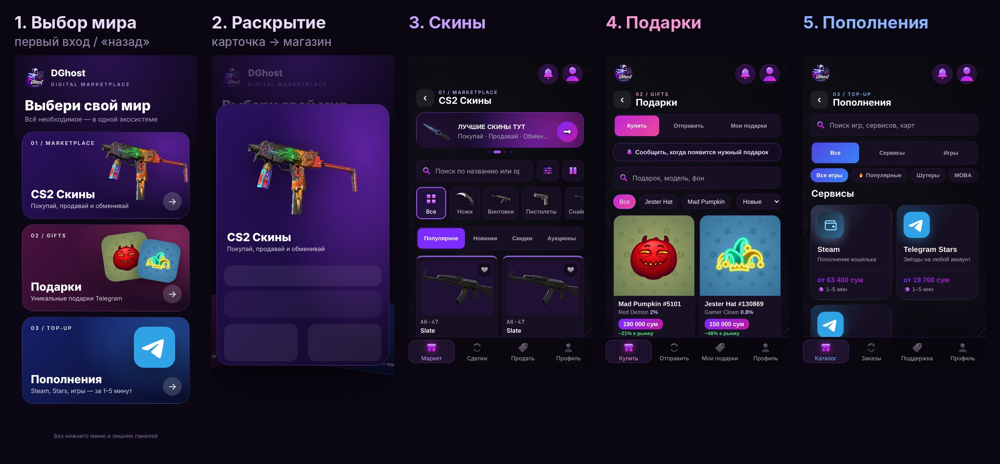

# DGhost — три пространства (Dynamic Service Navigation)

Задание для разработчика или агента, который подключается к репозиториям. Здесь всё, что решил владелец, и привязка к текущему коду.

- **Мини-апп и сайт:** `jaydensullivan/dghost-market-app`. Этот файл лежит здесь, в `docs/SPACES-NAVIGATION.md`.
- **Бот и бэкенд:** `jaydensullivan/dghostmarket-bot`.

Эскизы:

- `docs/spaces/sketch-all.jpg` — все кадры: выбор → раскрытие → Скины → Подарки → Пополнения.
- `docs/spaces/chooser.jpg` — стартовый экран крупно.



---

## 1. Идея

**Один DGhost — три самостоятельных пространства.** Это не три магазина, не три приложения и не три бота.

| № | Пространство | Что внутри | Цвет-акцент |
|---|---|---|---|
| 01 | **CS2 Скины** (MARKETPLACE) | P2P-маркет скинов с гарантом: витрина, сделки, продажа, аукционы | фиолетовый `#7c3aed → #9333ea` |
| 02 | **Подарки** (GIFTS) | уникальные подарки Telegram (P2P) и магазин обычных подарков | розово-фиолетовый `#c026d3 → #ec4899` |
| 03 | **Пополнения** (TOP-UP) | Steam, Telegram Stars и Premium, игровые валюты (Arcadezy) | сине-фиолетовый `#4f46e5 → #3b82f6` |

Слово «Донат» в интерфейсе не используем: везде **«Пополнения»**.

Общими остаются аккаунт, профиль, **баланс**, уведомления, поддержка, реферальная программа и история операций. В каждом пространстве свои витрина, поиск, фильтры, главное действие и нижнее меню.

## 2. Состояния и переходы

Один контейнер с состояниями: `HOME` (выбор), `SKINS`, `GIFTS`, `TOPUP`.

**HOME — экран «Выбери свой мир»** (см. `docs/spaces/chooser.jpg`).

- Логотип, «DGhost / DIGITAL MARKETPLACE», заголовок «Выбери свой мир», подзаголовок «Всё необходимое — в одной экосистеме».
- Три высокие карточки с градиентом своего цвета, номером («01 / MARKETPLACE»), названием, одной строкой описания, картинкой и кнопкой «→».
- **Нет** нижнего меню, баланса, поиска. На этом экране не грузим 3D и каталоги.

**Когда показывать HOME:**

- при первом входе (ключ в `localStorage` пуст);
- по «Назад» из корня пространства;
- по тапу на логотип.

**Когда не показывать:**

- В остальных случаях сразу открываем последнее пространство. Ключ `localStorage`: `dg_space`, значения `skins|gifts|topup`. Доступ к `localStorage` оборачивать в `try/catch`.
- Если пришла deep-link-ссылка, HOME пропускаем всегда (см. §5).

**Переход HOME → пространство:**

- Выбранная карточка раскрывается в интерфейс магазина (shared element). Две другие уезжают в стороны и гаснут.
- Реализация: View Transitions API (`document.startViewTransition`), если он есть. Иначе простое затухание и появление (fade) за 200–250 мс.
- При «Меньше анимаций» (`html.dg-calm` из `app-motion.js`, учитывает `prefers-reduced-motion`) переход мгновенный.

**Возврат пространство → HOME:**

- Обратная анимация.
- Состояние пространства сохраняется: поиск, фильтры, выбранная категория и вкладка, прокрутка. Пространства прячем, а не пересоздаём.

**«Назад»:**

- Основной способ — **кнопка Telegram BackButton**. В `app-telegram.js` уже есть `syncTgBackButton()`, расширить её: в корне пространства «Назад» ведёт на HOME, на внутренних экранах — как сейчас.
- В вебе (вне Telegram) — своя кнопка «‹» в шапке пространства.
- Дополнительно свайп от левого края вправо: старт не дальше 20 px от края, горизонтальное движение больше 60 px, вертикальное меньше 30 px.
- Свайп не должен перехватываться в каруселях, горизонтальных лентах чипов и в 3D-просмотрщике.
- Проверить на iPhone и Android: на iPhone Telegram сам может реагировать на жесты.

## 3. Навигация по пространствам

Логика у всех одна: **первые кнопки свои, «Профиль» с балансом всегда последний.**

| Состояние | Шапка | Нижнее меню |
|---|---|---|
| HOME | только логотип | **нет** |
| SKINS | «‹ 01 / MARKETPLACE — CS2 Скины», уведомления, профиль | Маркет · Сделки · Продать · Профиль |
| GIFTS | «‹ 02 / GIFTS — Подарки», уведомления, профиль | Купить · Отправить · Мои подарки · Профиль |
| TOPUP | «‹ 03 / TOP-UP — Пополнения», уведомления, профиль | Каталог · Заказы · Поддержка · Профиль |

**«Продать»** есть только в Скинах. Продажа подарков — это «Мои подарки» → «Выставить», как уже сделано.

Что должно отличаться внутри пространств:

| | Скины | Подарки | Пополнения |
|---|---|---|---|
| Главный экран | каталог скинов | каталог подарков | категории сервисов |
| Поиск | название, оружие | название, модель, фон | игра, сервис |
| Фильтры | float, цена, износ | редкость, цена | валюта, номинал |
| Главное действие | Купить / Продать | Купить / Отправить | Пополнить |
| Личный раздел | Мои лоты / Сделки | Мои подарки | История заказов |

**Цвет пространства:**

- Задаётся через CSS-переменные на контейнере: `--space-a`, `--space-b`, `--space-glow`.
- Им красятся активная кнопка нижнего меню, активные вкладки и чипы, главные кнопки.
- Карточки товаров целиком не красить.
- Цвета вынести в `:root` и в тему (светлая и тёмная).

## 4. Привязка к текущему коду мини-аппа

| Что | Где сейчас |
|---|---|
| Переключение экранов | `switchTab(name)` в `app-navigation.js` (экраны `screenShop`, `screenGifts`, `screenTopup`, `screenDeals`, `screenLots`, `screenProfile`, …) и `goToScreen()` |
| Анимации экранов, «Меньше анимаций» | `app-motion.js` (`dgMotionScreen`, класс `dg-calm`) |
| Нижнее меню | `#bottomNav.bottom-nav`: `#tabShopBtn`, `#tabDealsBtn`, `#tabLotsBtn`, `#tabProfileBtn`, подписи `.nav-label` с i18n-ключами `nav_market`, `nav_deals`, `nav_sell`, `nav_profile`; бегунок `#navPill` |
| Главная скинов (телефон) | `#screenShop`: `#promo`, `#newbieTip`, `.shop-search-row`, `#gtStrip`, `#giftsEntry`, `#categoryChips`, `#shopTabs`, сетка `#skinsList` (карточки `.skin-card`) |
| Главная скинов (ПК) | `app-desktop.js`: `#dtHero` («Выгода дня», 3D), `.dt-trust`, `#dtFresh` |
| Подарки | `app-gifts.js`, экран `#screenGifts`, вкладки `setGiftsTab()`, загрузка `loadGiftsScreen()` |
| Пополнения | `app-gametopup.js`, экран `#screenTopup` (`#gtCatalogView` / `#gtDetailView`), загрузка `loadTopupScreen()`, лента на главной `#gtStrip` |
| Запуск по ссылке | `openScreenFromLaunch()` в `app-telegram.js` (`?open=` и `start_param`) |
| Кнопка «Назад» Telegram | `syncTgBackButton()` в `app-telegram.js` |
| Тексты | `app-i18n.js` (RU), `app-i18n-uz.js`, `app-i18n-en.js` |

Что убрать с главной Скинов, раз у Пополнений и Подарков свои пространства:

- `#gtStrip` и `#giftsEntry`;
- `#newbieTip` — тонкой строкой или убрать;
- `.dt-trust` на ПК — тонкой строкой под «Выгодой дня» или убрать.

На первом экране телефона должен быть виден хотя бы ряд лотов.

Мелочи в карточке `.skin-card` (в той же работе):

- убрать дублирующий `.skin-float` (длинный float 10 px, короткий уже есть в `.skin-meta-float`);
- кнопку «Купить» сделать 13 px без капса.

## 5. Ссылки (deep links): обязательно сохранить старые

Все существующие ссылки должны работать как раньше и открывать сразу нужное пространство, минуя HOME.

| Ссылка | Пространство → экран |
|---|---|
| `startapp=gift_<id>` | GIFTS → карточка подарка (`openGiftById`) |
| `?open=gifts` | GIFTS → «Мои подарки» |
| `?open=topup`, `startapp=topup` | TOPUP |
| `deals`, `sell`, `search`, `wants`, `pro` | SKINS → соответствующий экран |

Новые: `startapp=space_skins`, `startapp=space_gifts`, `startapp=space_topup`. Нужны для кнопок бота и постов.

## 6. ПК-версия

- **HOME:** три большие карточки в ряд.
- **Внутри пространства:** верхнее меню этого пространства, вместо нижнего. Справа в шапке маленький переключатель пространств (три иконки), чтобы на ПК не возвращаться на HOME.
- **«Выгода дня» (3D):**
  - сначала показывать картинку скина;
  - 3D-модель (`.glb`, ~4 МБ) подгружать по наведению или через 2–3 с после загрузки;
  - на HOME 3D не грузить вообще.

## 7. Бот (`dghostmarket-bot`)

- `/start`: три кнопки web_app — «🔫 Скины CS2», «🎁 Подарки Telegram», «⚡ Пополнения». Каждая открывает мини-апп с `?open=space_skins|space_gifts|space_topup`.
- Кнопки под постами в канале ведут в нужное пространство. Подарки уже ведут через `startapp=gift_<id>`.
- Бэкенд не трогать без необходимости: API у трёх направлений уже раздельные (`/api/skins…`, `/api/gifts/*`, `/api/game_topup/*`).

## 8. Порядок работ (отдельный PR на каждый этап)

1. **Каркас.**
   - Состояния HOME/SKINS/GIFTS/TOPUP, экран выбора, «Назад» через BackButton, запоминание `dg_space`, deep links.
   - Своё нижнее меню у каждого пространства, переименование «Донат» → «Пополнения».
   - Сжатая главная Скинов, мелочи в карточке.
2. **Анимации:** раскрытие карточки (View Transitions + fallback), свайп от края, сохранение состояния пространств.
3. **Цвета и фильтры** каждого пространства. Единая «История заказов» в Пополнениях.
4. **ПК-версия** (§6) и **бот** (§7).

## 9. Правила репозитория (обязательно)

Перед PR в мини-аппе, как в `CLAUDE.md`:

```bash
node tools/version-check.js origin/main   # изменённым app-*.js / app.css поднят ?v= в index.html (и embed.html)
node tools/i18n-check.js                  # ключи RU/UZ/EN совпадают
node tools/lint-check.js                  # несуществующие функции, повторные ключи, недостижимый код
```

- Функции из лениво грузящихся файлов (`app-3d.js`, `app-admin.js`) вызывать только с проверкой `typeof X === 'function'` в той же строке.
- Все новые тексты — сразу в трёх словарях (RU, UZ, EN).
- **Бот:**
  - `ruff check *.py --select F,RUF006`;
  - `ruff check tests --select F --ignore F841`;
  - `python -m py_compile bot.py`;
  - `python -m unittest discover -s tests`.

  Для запуска модулей нужны `BOT_TOKEN=1:x CHANNEL_ID=-1 ADMIN_ID=1`.
- **Порядок PR:** работать в своей ветке, коммитить, пушить, открывать PR. Владелец мержит сам: сначала бот, потом мини-апп.
- Минуты GitHub Actions могут быть исчерпаны, тогда CI красный «404 на логи». В этом случае один комментарий в PR с результатами локальных проверок.
- **Проверка вида:** Playwright, скриншоты iPhone 13 и 1440×900:
  - HOME;
  - каждое пространство;
  - «Назад»;
  - deep link `gift_<id>` и `topup`;
  - светлая и тёмная тема;
  - «Меньше анимаций».

## 10. Готово, когда

- [ ] Первый вход → HOME. Выбор пространства запоминается, следующий вход открывает его сразу.
- [ ] «Назад» в корне пространства → HOME. Состояние пространства сохранено.
- [ ] У каждого пространства своё нижнее меню, «Профиль» последний. На HOME меню нет.
- [ ] Все старые ссылки (`gift_<id>`, `topup`, `gifts`, `deals`, `sell`, `search`, `wants`, `pro`) открывают нужное без HOME.
- [ ] На телефоне на первом экране Скинов виден ряд лотов.
- [ ] «Меньше анимаций» → переходы мгновенные. Свайп не ломает карусели и 3D.
- [ ] RU/UZ/EN полные, проверки `tools/*` зелёные, `?v=` подняты.
- [ ] На HOME не грузятся 3D и каталоги (вес первого экрана не больше, чем сейчас).
